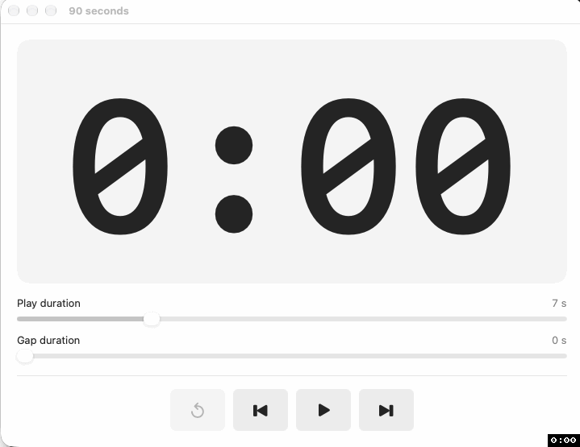

# 90 Seconds

## Demo



## Running

```
Apple could not verify “90 seconds.app” is free of malware that may harm your Mac or compromise your privacy.
```

Now you have three choices:

1. Give up 😊
2. Download and built it yourself (see instructions below)
3. Tell MacOS to ignore this and run the app anyway.

On the last option, do this:

```bash
# if in Applications
xattr -dr com.apple.quarantine "/Applications/90 seconds.app"

# if in downloads
xattr -dr com.apple.quarantine ~/Downloads/90\ seconds.app
```


## Internal workflow

```mermaid
swimlane-beta LR

    subgraph play [Play phase]
        resetClock["Reset timer to 00:00"]
        incrementTimer["Increment timer"]
        reachedEnd{"2 seconds left (or less)"}
        saveVolume["Save the current volume"]
        fadeOut["Fadeout with the remaining time"]
    end

    subgraph gap [Gap phase]
        checkGap{"Is gap >0?"}
        runGapPhase["Send play/pause (will pause the player)"]
        resetGapClock["Reset timer to 00:00"]
        incrementGapTimer["Increment gap timer"]
        reachedGapEnd{"End of gap timer?"}
    end

    subgraph prepNext [Prep for next song]
        sendNextSongCommand["Play next song"]
        restoreVolume["Restore the volume to previous volume"]
    end

    resetClock --> incrementTimer
    incrementTimer --> reachedEnd
    reachedEnd -->|Yes| saveVolume
    reachedEnd -->|No| incrementTimer
    saveVolume --> fadeOut
    fadeOut --> checkGap
    checkGap -->|Yes| runGapPhase
    checkGap -->|No| sendNextSongCommand
    runGapPhase --> resetGapClock
    resetGapClock --> incrementGapTimer
    incrementGapTimer --> reachedGapEnd
    reachedGapEnd -->|Yes| sendNextSongCommand
    reachedGapEnd -->|No| incrementGapTimer
    sendNextSongCommand --> restoreVolume
    restoreVolume --> resetClock
```

## Debugging

Go to the application menu -> View -> "Enable debugging window"

```bash
# Deep dive logging
/usr/bin/log stream --level info --predicate 'process == "90 seconds"'
```

## Building

In order to build, you need Apples official `Xcode` tool installed.

Open the terminal.app and do the following:

```bash
# Clone the repository
cd ~/Desktop
git clone https://github.com/triplestepab/90seconds.git

# Switch folder
cd 90seconds

# Create the application inside the "dist" folder (this will output a _lot_ of information)
./build.sh

# The build succeeds with the following message
Successfully built /Users/<your-username>/Desktop/90seconds/dist/90 seconds.app
```

Next open the Finder and go to `~/Desktop/90seconds/dist`
